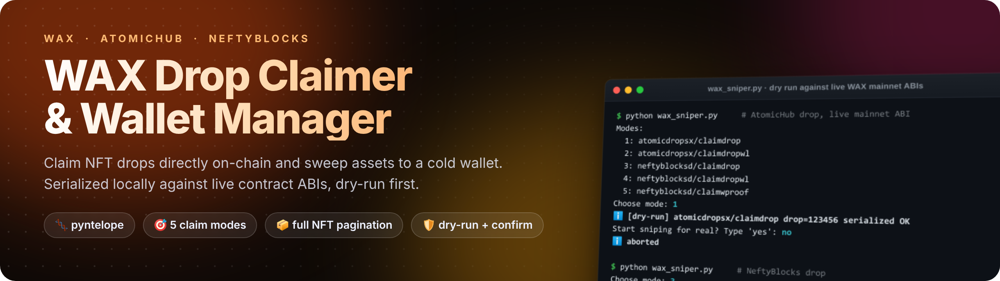
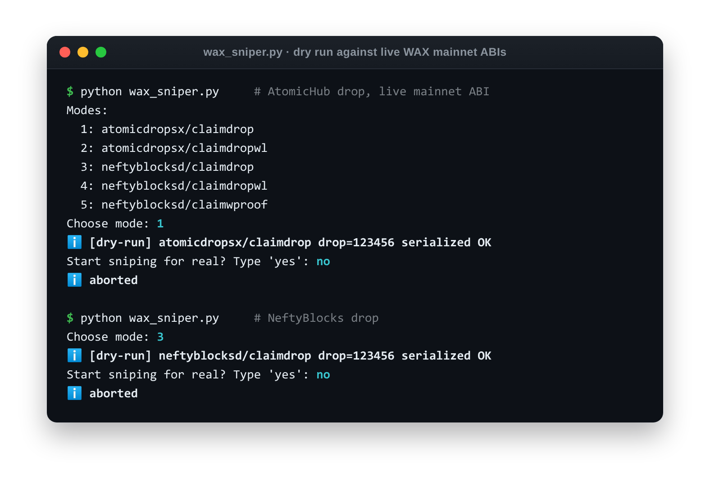
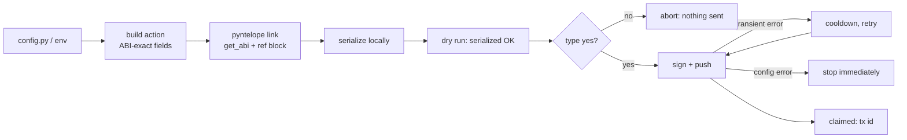
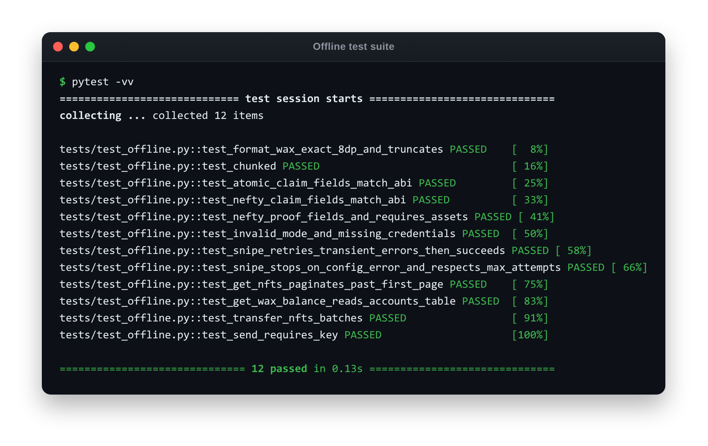

<div align="center">



<br><br>

[](#-install)
[](#-why-pyntelope)
[](https://wax.io/)
[](#-tests)
[](#-how-a-claim-works)

**[Features](#-features) · [How a claim works](#-how-a-claim-works) · [Install](#-install) · [Configure](#-configure) · [Usage](#-usage) · [Tests](#-tests)**

</div>

---

Python tools for the **WAX** blockchain:

- **`wax_sniper.py`** claims NFT drops directly on-chain from **AtomicHub** (`atomicdropsx`) and **NeftyBlocks** (`neftyblocksd`), without going through the slower web UIs.
- **`wax_manager.py`** reads your WAX balance and full NFT inventory, then sweeps WAX or NFTs to a cold wallet.

Every write gets a **dry run first**. The transaction is built and serialized against the contract's live ABI, and nothing is sent until you type `yes`.

<p align="center">
  
  <br>
  <sub>Real dry runs against <b>live WAX mainnet</b> ABIs. The claim is built and serialized locally, and nothing is signed or sent.</sub>
</p>

## ✨ Features

<table>
<tr>
<th width="50%">🎯 Drop claimer <code>wax_sniper.py</code></th>
<th width="50%">👛 Wallet manager <code>wax_manager.py</code></th>
</tr>
<tr valign="top">
<td>

| Mode | Contract | Action |
|:-:|---|---|
| 1 | AtomicHub `atomicdropsx` | `claimdrop` (public) |
| 2 | AtomicHub `atomicdropsx` | `claimdropwl` (whitelist) |
| 3 | NeftyBlocks `neftyblocksd` | `claimdrop` (public) |
| 4 | NeftyBlocks `neftyblocksd` | `claimdropwl` (whitelist) |
| 5 | NeftyBlocks `neftyblocksd` | `claimwproof` (proof of ownership) |

- 🧾 Action data matches **each contract's on-chain ABI**. Atomic uses a `uint64 claim_amount`; Nefty uses a `uint32 amount` plus `currency` and `referrer_account`.
- 🔁 Retries **transient** failures (rate limits, node hiccups, drop not yet open) with a cooldown. **Configuration** errors stop immediately instead of looping forever.

</td>
<td>

- 💰 Liquid WAX balance from the `eosio.token` `accounts` table
- 📦 **Complete** NFT inventory through the AtomicAssets API. It paginates, so wallets with more than 100 NFTs are fully covered.
- 🎯 Sends WAX with exact 8-decimal formatting (`Decimal`, truncating, never rounding up)
- 🚚 Sweeps NFTs to a cold wallet in **batches of 100** to stay within transaction size and CPU limits
- 🛡️ Refuses to run if the cold wallet is the same as the source account

</td>
</tr>
</table>

## 🧭 How a claim works



## 🧬 Why `pyntelope`

The original version used `eospy` together with the node's `abi_json_to_bin` endpoint. That approach **no longer works**:

1. The `eospy` package on PyPI is a 2018 placeholder (v0.0.2) with no `eospy.cleos` module, so `import` fails.
2. Modern WAX nodes (Greymass, EOS Sweden, EOSUSA, …) have **disabled** `/v1/chain/abi_json_to_bin`, which now returns 404.

This version uses **[`pyntelope`](https://pypi.org/project/pyntelope/)**, which fetches each contract's ABI through the still-supported `get_abi` endpoint and **serializes transactions locally**.

## 📦 Install

Requires **Python 3.10+**.

```bash
python -m venv .venv
source .venv/bin/activate          # Windows: .venv\Scripts\activate
pip install -r requirements.txt
```

## ⚙️ Configure

```bash
cp config_example.py config.py     # config.py is git-ignored
```

Set secrets through environment variables (preferred) or directly in `config.py`:

| Setting | Env var | Meaning |
|---|---|---|
| `CLAIMER` | `WAX_ACCOUNT` | Your WAX account name |
| `ACC_PK` | `WAX_PRIVATE_KEY` | Private key of its `active` permission |
| `RPC_URL` | `WAX_RPC` | Node URL (default: Greymass) |
| `DROP_ID`, `AMOUNT`, `CURRENCY`, `COUNTRY`, `COOLDOWN`, `ASSET_IDS` | | Claimer settings |
| `COLD_WALLET` | | Destination for `wax_manager.py` sweeps |

> [!IMPORTANT]
> Use a dedicated hot wallet that holds only what you need, ideally with a custom permission limited to the claim and transfer actions. Never commit `config.py`.

## 🚀 Usage

```bash
python wax_sniper.py     # choose a mode → dry run → type "yes" to start
python wax_manager.py    # 1: send WAX, 2: sweep all NFTs → dry run → "yes"
```

> [!NOTE]
> **Fair use:** follow each drop's rules and the platforms' terms. Many drops cap claims per account or use whitelists for a reason. This tool is for claiming **your own** allocation reliably, not for evading limits with multiple accounts.

> [!TIP]
> For compact logs like in the screenshots, set `LOGURU_FORMAT='{level.icon} <level>{message}</level>'`.

## 🧪 Tests

```bash
pip install -r requirements-dev.txt
pytest
```

There are 12 offline tests (no network, no keys). They cover amount formatting, claim action fields against each contract's ABI, retry and stop semantics, NFT pagination beyond the first page, balance parsing, and transfer batching.

<p align="center">
  
</p>

The code was also checked read-only against **live WAX mainnet**: balance read, full NFT pagination (9,960 assets in one test wallet), and dry-run serialization of all 5 claim modes and both transfer types against the real contract ABIs.

## 🗂 Project structure

```text
├── wax_sniper.py        # Drop claimer: 5 modes, dry run → confirm → retry loop
├── wax_manager.py       # Balance, full NFT inventory, WAX send, NFT sweep
├── config_example.py    # Copy to config.py (git-ignored); env vars preferred
├── tests/               # 12 offline tests
├── docs/assets/         # README images
└── requirements.txt
```

<details>
<summary><b>📝 Changelog: 2026 modernization</b></summary>

<br>

- **Fixed:** wrong dependency. `requirements.txt` pulled `eospy` 0.0.2, which has no `eospy.cleos`, so nothing could import.
- **Fixed:** transactions were serialized with node-side `abi_json_to_bin`, which is now disabled on WAX nodes. Serialization now happens locally with `pyntelope`.
- **Fixed:** the default RPC `wax.eos.barcelona` no longer resolves. Greymass is the new default and can be overridden.
- **Fixed:** `config_example.py` lacked `DROP_ID`, `AMOUNT`, `PRICE`, and `COOLDOWN`, so the sniper crashed with `ImportError` on start.
- **Fixed:** `claim_drop()` never returned a value, so the retry loop never saw success and **never stopped**, even after a successful claim.
- **Fixed:** Atomic mode always sent a `currency` field the contract doesn't have, and Nefty sent the wrong amount type and was missing `referrer_account`. Every claim was rejected.
- **Fixed:** "Atomic Proof" (`atomicdropsx/claimwproof`) doesn't exist on-chain and has been removed. Nefty proof mode never passed the configured asset IDs.
- **Fixed:** the NFT list stopped at the first 100 assets. It now paginates through the full inventory.
- **Fixed:** `wax_manager` used a hard-coded placeholder key and accounts. It now reads config, adds a cold-wallet ≠ source check, and requires a dry run plus confirmation.
- **Added:** NFT transfer batching, `Decimal` WAX amounts, a max-attempts option, and 12 tests.

</details>
